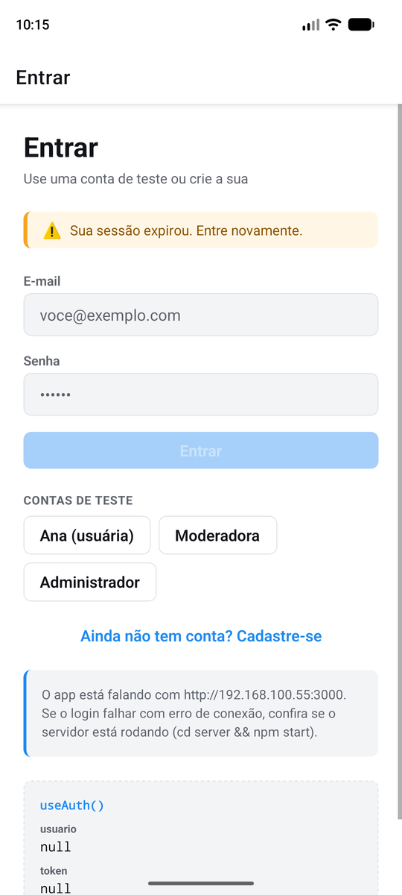

# Trabalho Prático II — Autenticação, Contexto e Rotas Protegidas

**Aluno(a):** Kethelem da Cruz Socoowski
**Disciplina:** Desenvolvimento de Aplicativos — 2026/2

Projeto feito a partir da **Aula 6** (`Aula06/`): o app Expo em React Native +
TypeScript e o servidor em Node.js (Express) com os dados em memória.

---

## 1. Como executar

São dois terminais.

```bash
# terminal 1 — o servidor (API em http://localhost:3000)
cd server
npm install
npm start
```

```bash
# terminal 2 — o app
npm install
npx expo start
```

Depois: `w` para o navegador, `a` para Android, `i` para iOS. No celular
físico, ele precisa estar na mesma rede Wi-Fi do computador (o app usa o IP do
computador que o Expo informa). Para apontar para outro endereço:
`EXPO_PUBLIC_API_URL=http://192.168.0.10:3000 npx expo start`.

### Contas de teste

Criadas sempre que o servidor sobe e listadas em `GET /` e no terminal:

| E-mail | Senha | Papel |
| --- | --- | --- |
| `ana@ifrs.edu.br` | `123456` | `usuario` |
| `moderador@ifrs.edu.br` | `mod123` | `moderador` |
| `admin@ifrs.edu.br` | `admin123` | `admin` |

A tela de login tem botões que preenchem cada uma dessas contas.

### O que cada papel enxerga

| | Anotações | Perfil | Moderação | Administração |
| --- | :---: | :---: | :---: | :---: |
| Ana (`usuario`) | ✅ | ✅ | ❌ | ❌ |
| Moderadora (`moderador`) | ✅ | ✅ | ✅ | ❌ |
| Administrador (`admin`) | ✅ | ✅ | ✅ | ✅ |

---

## 2. Rotas do servidor

`(token)` = precisa do cabeçalho `Authorization: Bearer <token>`.

| Método | Rota | Quem pode | Recebe | Devolve |
| --- | --- | --- | --- | --- |
| `GET` | `/` | todos | — | contas de teste e lista de rotas |
| `POST` | `/auth/cadastro` | todos | `{ nome, email, senha }` | `201 { token, usuario }` · `400` · `409` |
| `POST` | `/auth/login` | todos | `{ email, senha }` | `200 { token, usuario }` · `400` · `401` |
| `GET` | `/auth/me` | (token) | — | `200 usuario` · `401` |
| `POST` | `/auth/logout` | (token) | — | `204` · `401` |
| `GET` | `/anotacoes` | (token) | — | `200 [anotacao]` (só as suas) · `401` |
| `POST` | `/anotacoes` | (token) | `{ texto }` | `201 anotacao` · `400` · `401` |
| `GET` | `/anotacoes/:id` | (token) | — | `200 anotacao` · `401` · **`404`** se não existe ou é de outra pessoa |
| `GET` | `/moderacao/anotacoes` | (token) `moderador`, `admin` | — | `200 [anotacao + autorNome]` · `401` · **`403`** para `usuario` |
| `GET` | `/usuarios` | (token) `admin` | — | `200 [usuario + totalAnotacoes]` · `401` · `403` |

---

## 3. Requisitos

### 4.1 Sessão expirada (`401`)

O tratamento do `401` ficou **em um lugar só: a função `protegida()`, dentro de
`src/services/api-logada.ts`**. O `AuthProvider` monta uma `apiLogada` com o
token da sessão e entrega pelo contexto. As telas não passam token nenhum:

```ts
const { apiLogada } = useAuth();
setAnotacoes(await apiLogada.listarAnotacoes());
```

Cada função da `apiLogada` chama a função correspondente do `api.ts` (que
continua sendo o único lugar com `fetch`) dentro de `protegida()`. Se a chamada
lançar um `ApiError` com `status === 401`, a `protegida()` avisa o contexto,
que chama `encerrarSessao(true)`, e **relança o erro** (a tela segue mostrando
mensagens de 403, 404, 500 e de conexão). O `encerrarSessao(true)` limpa a
sessão do estado e do AsyncStorage e guarda `avisoLogin = 'sessao-expirada'`.
Como `usuario` virou `null`, o `Stack.Protected` do layout raiz remove o grupo
`(app)` e o app vai para o login **sozinho**, sem `router.replace()`.

* **`403` não desloga:** a `protegida()` só reage ao `401`. Um `403` sobe para
  a tela como qualquer outro erro e aparece na `MensagemErro`.
* **Erro de conexão (status `0`) também não desloga:** testado parando o
  servidor e tocando em *Conferir token no servidor*.
* Usam a `apiLogada`: anotações (lista e criação), detalhe da anotação, perfil
  (*Conferir token no servidor*), administração e moderação.
* O aviso aparece no login pelo componente novo `AlertaSessao`
  (`src/components/alerta-sessao.tsx`). O contexto guarda só o **motivo**
  (`'sessao-expirada'` ou `'servidor-fora-do-ar'`), e o componente decide o
  texto. No logout voluntário o motivo é `null`, então nada aparece.
* `encerrarSessao(true)` **não** chama `POST /auth/logout`: o token já não
  existe no servidor, e a chamada só daria outro `401`.
* `encerrarSessao` é interna do contexto. As telas só enxergam `sair()`, sem
  parâmetro, que chama `encerrarSessao(false)`. Assim nenhuma tela consegue
  "fingir" uma sessão expirada.

**Por que não tratar direto no `api.ts`?** O `api.ts` não conhece o estado do
React, então não teria como deslogar. A `apiLogada` recebe do provider o token
e a função que encerra a sessão. Assim o serviço continua sem depender do
React, e a regra do 401 fica num lugar só.

Arquivos: `src/services/api-logada.ts` (novo), `src/contexts/auth-context.tsx`,
`src/components/alerta-sessao.tsx` (novo), `src/app/(auth)/login.tsx`,
`src/app/(app)/anotacoes/index.tsx`, `src/app/(app)/anotacoes/[id].tsx`,
`src/app/(app)/perfil.tsx`, `src/app/(app)/admin.tsx`,
`src/app/(app)/moderacao.tsx`.

### 4.2 Estado `carregando` no contexto

`carregando` faz parte do `AuthContextValue`. `entrar()` e `cadastrar()`
chamam a mesma função interna, `autenticar()`, que coloca `carregando` em
`true` e, em um `finally`, de volta em `false`. Assim a tela de
espera vai embora tanto no sucesso quanto no erro. O estado local `enviando`
das telas de login e cadastro deixou de existir: agora é o `carregando` do
contexto que desabilita o botão.

Quem mostra a tela de espera é o layout raiz (`src/app/_layout.tsx`), com o
componente novo `TelaDeEspera` (`src/components/tela-de-espera.tsx`):
`ActivityIndicator` e a mensagem *"Conferindo seus dados no servidor…"*.

**Resposta — como o erro do login não se perde:** a tela de espera é
renderizada **por cima** do `<Stack>`, e não **no lugar** dele:

```tsx
<View style={styles.container}>
  <Pilha logado={logado} />
  {carregando ? <TelaDeEspera mensagem="…" /> : null}
</View>
```

A `TelaDeEspera` usa `StyleSheet.absoluteFill` e cobre a tela, mas a tela de
login **continua montada** embaixo. Por isso o estado local dela (os campos e
o `erro`) sobrevive. Quando o login falha, `carregando` volta a `false`, a
sobreposição some e a tela de login, que nunca saiu da árvore, faz
`setErro(...)` normalmente.

Se o layout trocasse o `<Stack>` pela `TelaDeEspera`
(`if (carregando) return <TelaDeEspera />`), o login seria desmontado: os
campos voltariam vazios e o `setErro` do `catch` iria para um componente que
não existe mais. A alternativa seria levar o erro do login para o contexto.
Preferi a sobreposição porque mantém a divisão da aula: **a sessão é do
contexto, o formulário é da tela.**

Arquivos: `src/contexts/auth-context.tsx`, `src/app/_layout.tsx`,
`src/components/tela-de-espera.tsx`, `src/app/(auth)/login.tsx`,
`src/app/(auth)/cadastro.tsx`.

### 4.3 Detalhes da anotação: `/anotacoes/[id]`

**Servidor:** a rota `GET /anotacoes/:id` passa pelo middleware `autenticado`
(sem token válido, `401`) e chama `banco.anotacaoDoDono(id, usuarioId)`.
Essa função devolve `null` tanto quando o id não existe quanto quando a
anotação é de outra pessoa, e a rota responde **`404`** nos dois casos. Um
`403` revelaria que aquele id existe.

**App:** `anotacoes.tsx` virou `anotacoes/index.tsx`, e a pasta ganhou
`anotacoes/[id].tsx`. O `AnotacaoItem` agora é um `Link` (com `asChild` e
`Pressable`) para `{ pathname: '/anotacoes/[id]', params: { id } }`. **Só o id**
vai pela rota. A tela lê o id com `useLocalSearchParams` e busca a anotação com
`apiLogada.buscarAnotacao(id)`.

Os estados da tela ficam num **único** `useState`, com um tipo que lista cada
caso:

```ts
type EstadoDaTela =
  | { tipo: 'carregando' }
  | { tipo: 'nao-encontrada' }
  | { tipo: 'erro'; mensagem: string }
  | { tipo: 'pronta'; anotacao: Anotacao };
```

Um `switch` desenha cada caso: carregando (`ActivityIndicator`), erro
(`MensagemErro` e *Tentar de novo*), `404` (tela própria, *"Essa anotação não
está disponível"*) e sucesso (componente `AnotacaoDetalhe`). Com um estado só,
a tela não tem como estar "carregando" e "com erro" ao mesmo tempo, e o
TypeScript só deixa ler `anotacao` no caso `'pronta'`.

A data aparece no formato `18/10/2026 às 19:05`, feito pela função
`dataHoraBR` (`src/utils/datas.ts`) com `Intl.DateTimeFormat`. Ela também é
usada na lista e na moderação.

**Resposta — por que a rota fica dentro de `(app)`:** o grupo `(app)` inteiro
está dentro de `<Stack.Protected guard={logado}>` no layout raiz. Tudo o que
está na pasta herda essa proteção: sem usuário, `/anotacoes/[id]` **não
existe** para o roteador. Também é dentro de `(app)` que a tela tem o que
precisa: um `usuario` e um `token` no contexto.

Se fosse criada **fora** do grupo (por exemplo `src/app/anotacoes/[id].tsx`),
ela ficaria fora dos dois `Stack.Protected` e existiria para qualquer pessoa,
logada ou não. Um link direto (na web, digitar o endereço) abriria a tela sem
login. Ela faria `GET /anotacoes/:id` sem token e receberia `401`. O servidor
continuaria protegendo o dado, mas a interface mostraria uma tela que não
deveria existir para aquele usuário. Além disso, ela ficaria fora da pilha de
`(app)`: não teria o cabeçalho e o botão de voltar dessa pilha.

Arquivos: `server/index.js`, `server/banco.js`, `src/services/api.ts`,
`src/app/(app)/anotacoes/index.tsx` (movido), `src/app/(app)/anotacoes/[id].tsx`
(novo), `src/app/(app)/_layout.tsx`, `src/components/anotacao-item.tsx`,
`src/components/anotacao-detalhe.tsx` (novo), `src/utils/datas.ts` (novo).

### 4.4 Papel `moderador`

No servidor, o `somenteAdmin` virou uma **fábrica de middlewares**:
`somentePapeis(...papeis)` devolve a função `(req, res, next)` que deixa passar
só os papéis informados e responde `403` para os demais. Assim:

```js
app.get('/moderacao/anotacoes', autenticado, somentePapeis('moderador', 'admin'), …);
app.get('/usuarios',            autenticado, somentePapeis('admin'), …);
```

`/moderacao/anotacoes` devolve todas as anotações com `autorNome`. O "join" é
feito em `banco.anotacoesComAutor()`, que percorre os usuários e reaproveita a
`listarAnotacoes()` de cada um. A conta `moderador@ifrs.edu.br` /
`mod123` é criada ao subir o servidor, junto com as outras.

No app, a tela `/moderacao` fica dentro de
`<Stack.Protected guard={podeModerar(usuario?.papel)}>`, e o início mostra o
link *Moderação* com a **mesma** função `podeModerar`, definida em
`src/models/usuario.ts`. O layout decide o que **existe** e o menu decide o que
**aparece**, os dois com a mesma regra. `/admin` continua com
`guard={usuario?.papel === 'admin'}`.

**Resposta — arquivos que mudaram para acrescentar o papel:**

| Arquivo | Motivo |
| --- | --- |
| `server/banco.js` | Conta de teste `moderador@ifrs.edu.br` e `anotacoesComAutor()` com o nome do autor. |
| `server/index.js` | Middleware `somentePapeis(...)` no lugar do `somenteAdmin`, rota `GET /moderacao/anotacoes` e a lista de rotas em `GET /`. |
| `src/models/usuario.ts` | `'moderador'` no tipo `Papel`, a função `podeModerar()` e o tipo `AnotacaoComAutor`. |
| `src/services/api.ts` | `api.listarAnotacoesModeracao(token)`. |
| `src/services/api-logada.ts` | `apiLogada.listarAnotacoesModeracao()`, a versão que as telas usam. |
| `src/app/(app)/_layout.tsx` | `Stack.Protected` da rota `moderacao` para moderador e admin. |
| `src/app/(app)/moderacao.tsx` | Tela nova com a lista de todas as anotações. |
| `src/app/(app)/index.tsx` | Link *Moderação* no início, só para moderador e admin. |
| `src/components/anotacao-moderacao-item.tsx` | Componente novo: item da lista com autor, data e a etiqueta "sua". |
| `src/app/(auth)/login.tsx` | Botão de atalho *Moderadora* nas contas de teste. |
| `src/components/usuario-item.tsx` | Destaque do papel `moderador` na lista da administração. |

### 4.5 Sessão que sobrevive ao *reload*

Usei `@react-native-async-storage/async-storage`, instalado com
`npx expo install`. Tudo fica no `AuthProvider`, e no aparelho fica salvo **só
o token** (chave `@trabalho02/token`). O usuário não é salvo: ele vem sempre do
servidor quando o app abre.

* **Gravação:** `entrar()` e `cadastrar()` chamam `iniciarSessao()`, que faz
  `setSessao` e depois `AsyncStorage.setItem('@trabalho02/token', token)`. Se a
  gravação falhar (por exemplo, navegador bloqueando o armazenamento), a pessoa
  entra mesmo assim. A sessão só não fica salva para o próximo reload.
* **Remoção:** `encerrarSessao()` faz `AsyncStorage.removeItem(...)` nos dois
  casos, voluntário e expirado (4.1). Sem isso, recarregar o app depois de um
  `401` tentaria usar um token morto.
* **Restauração:** um `useEffect(..., [])` chama `conferirSessaoSalva()`, que lê
  o token salvo e o confere com `api.perfil(token)` (`GET /auth/me`):
  * token válido → `setSessao({ token, usuario })`, e o usuário entra direto;
  * `401` → apaga o token salvo e o login aparece, com o aviso de sessão
    expirada;
  * nada salvo → o login aparece.

**Sem "piscar" o login:** o estado `verificandoSessao` começa em **`true`**.
Enquanto ele é `true`, o layout raiz **não monta o `<Stack>`** e devolve só a
`TelaDeEspera` (*"Verificando sua sessão…"*). Se o `<Stack>` fosse montado com
`usuario === null`, o guard mostraria o login por um instante antes de a
verificação terminar. Montando depois, a primeira rota já é a certa. Na web,
isso ainda preserva o endereço: recarregar em `/anotacoes` volta para
`/anotacoes`, e não para o início.

**Resposta — servidor fora do ar na abertura do app (status `0`):** decidi
**não apagar o token e não entrar sem conferir**. O app sai da tela de espera,
mostra o login e o aviso de servidor fora do ar (`avisoLogin =
'servidor-fora-do-ar'`). Os motivos:

* entrar com a sessão salva sem confirmar deixaria o usuário em um app "logado"
  em que nenhuma tela funciona, o mesmo problema que o 4.1 resolve;
* apagar o token seria perder uma sessão que talvez ainda valha: o servidor
  pode só estar lento ou a rede pode ter caído.

Quando o servidor voltar, basta recarregar o app: o token salvo é conferido de
novo e, se ainda valer, a pessoa entra sem digitar a senha. Se ela preferir
entrar de novo pelo login, a nova sessão substitui a salva.

Arquivos: `src/contexts/auth-context.tsx`, `src/app/_layout.tsx`,
`src/components/tela-de-espera.tsx`, `package.json` (dependência nova).

### 4.6 Análise: funções recriadas a cada render

**Por que poderia ser um problema?** Todo componente que chama `useAuth()`
assina o contexto. O React compara o `value` novo com o anterior por
**referência** (`Object.is`). Como o `AuthProvider` monta
`value={{ usuario, token, entrar, … }}` dentro da renderização, **cada
renderização do provider cria um objeto novo**. As funções `entrar`, `sair` e
o objeto `apiLogada` também são novos. Então, sempre que o provider renderizar, **todos
os leitores renderizam de novo**: o layout raiz, o layout de `(app)`, as telas,
o `SessaoAtual`… Isso vale mesmo se `usuario` e `token` forem os mesmos. O
problema aparece quando o provider renderiza *sem* que o conteúdo do contexto
tenha mudado, por exemplo quando o componente pai dele renderiza de novo.

**É um problema neste projeto?** Não. O `AuthProvider` só renderiza quando o
**próprio estado** muda (`sessao`, `carregando`, `verificandoSessao` ou
`avisoLogin`). O
pai dele, o `RootLayout`, não tem estado nem props que mudem. Em toda
renderização do provider, o conteúdo do contexto mudou de fato, e os leitores
**precisariam** renderizar de qualquer forma. E o projeto tem
`"reactCompiler": true` em `app.json`. O React Compiler analisa o componente na
compilação e memoriza automaticamente valores, funções e JSX, com base no que
cada um usa. Na prática ele faz o que faríamos à mão com `useMemo` e
`useCallback`: o objeto `value` só é recriado quando muda algo de que ele
depende.

**Sem o React Compiler**, a solução manual seria:

```tsx
const sair = useCallback(async () => { … }, [sessao]);
const entrar = useCallback(async (email: string, senha: string) => { … }, []);
// … o mesmo para cadastrar
const apiLogada = useMemo(
  () => criarApiLogada(sessao?.token ?? null, () => encerrarSessao(true)),
  [sessao],
);

const value = useMemo(
  () => ({
    usuario: sessao?.usuario ?? null,
    token: sessao?.token ?? null,
    carregando, verificandoSessao, avisoLogin,
    entrar, cadastrar, sair, apiLogada,
  }),
  [sessao, carregando, verificandoSessao, avisoLogin, entrar, cadastrar, sair, apiLogada],
);
return <AuthContext value={value}>{children}</AuthContext>;
```

`useCallback` mantém a mesma função entre renderizações enquanto as
dependências não mudam. `useMemo` faz o mesmo com o objeto. Assim o `value` só
muda de referência quando o conteúdo muda.

**Evidência.** Coloquei um `console.log` em um leitor do contexto, o
`SessaoAtual` (`src/components/sessao-atual.tsx`), e contei as linhas
`[render] SessaoAtual…` no console do navegador (app na web, `w`) em duas
situações, com o compilador ligado e desligado. Para desligar, mudei
`"reactCompiler"` para `false` no `app.json` e reiniciei com
`npx expo start --clear`:

| Situação | `reactCompiler: true` | `reactCompiler: false` |
| --- | :---: | :---: |
| Digitar 5 letras no campo de e-mail do login | **0** renderizações | **5** renderizações |
| Fazer login como Ana (do toque em *Entrar* até o início) | 2 renderizações | 2 renderizações |

Leitura dos números:

* **Login, 2 nos dois casos:** o provider renderizou porque o estado mudou
  (`carregando` virou `true`, e depois chegou a `sessao`). Nesses momentos o
  conteúdo do contexto mudou de verdade, então o leitor precisava renderizar,
  com ou sem memorização. Isso confirma que, neste projeto, objeto e funções
  recriados não causam renderizações a mais por causa do **contexto**.
* **Digitação, 5 contra 0:** ao digitar, o provider **nem renderiza** (o estado
  do formulário é da tela). As 5 renderizações sem o compilador vêm do
  `LoginScreen`, que é pai do `<SessaoAtual />` e renderiza a cada tecla. Com o
  compilador, o JSX `<SessaoAtual />`, que não tem props, é memorizado e o
  filho é pulado. É o mesmo mecanismo que manteria o `value` do contexto
  estável se o provider renderizasse à toa.

> Para repetir: abra o console do navegador, entre na tela de login e digite no
> campo de e-mail. Depois troque o `reactCompiler` no `app.json` e compare.

---

## 4. Componentes e organização

Mantive a separação da aula:

| Pasta | Novidades |
| --- | --- |
| `src/app/` | `(app)/anotacoes/index.tsx` (movido), `(app)/anotacoes/[id].tsx`, `(app)/moderacao.tsx` |
| `src/components/` | `TelaDeEspera`, `AlertaSessao`, `AnotacaoDetalhe`, `AnotacaoModeracaoItem` (e o `AnotacaoItem` virou link) |
| `src/contexts/` | `auth-context.tsx`: `carregando`, `verificandoSessao`, `avisoLogin`, `apiLogada`, AsyncStorage |
| `src/services/` | `api.buscarAnotacao`, `api.listarAnotacoesModeracao` e o `api-logada.ts` (chamadas com token e tratamento do 401) |
| `src/models/` | `Papel` com `'moderador'`, `podeModerar()`, `AnotacaoComAutor` |
| `src/utils/` | `datas.ts` com `dataHoraBR()` (pasta nova, para uma função que não é tipo nem componente) |
| `server/` | Regras de acesso em middlewares (`autenticado`, `somentePapeis`). Acesso aos dados em `banco.js` |

Sobre TypeScript: não há `any` no projeto. Nos `catch`, o status é lido com
`e instanceof ApiError`. O `AuthContextValue` tem os campos novos, e
`npx tsc --noEmit` passa sem erros.

Nenhuma tela chama `fetch` (só o `api.ts`). Nenhuma tela chama
`router.replace()` ou `router.push()` para levar ao login ou ao início. O único
`router.push` que sobrou é o botão didático *"Tentar abrir /admin mesmo
assim"*, que já vinha da aula.

---


## 5. Screenshots

> _Colocar as imagens na pasta `docs/` e manter os nomes abaixo._

| Tela de espera | Detalhe de uma anotação |
| --- | --- |
|  |  |

| Moderação | Sessão expirada no login |
| --- | --- |
|  |  |

---

## 6. Roteiro de testes (checklist do enunciado)

1. Subir o servidor: o terminal lista as **três** contas.
2. Senha errada → a tela de espera aparece, depois o login volta **com o erro e
   os campos preenchidos**.
3. Entrar como Ana → tocar em uma anotação → `/anotacoes/<id>` com texto e data.
4. Entrar como Moderadora → ver o link *Moderação* e abrir; `/admin` não existe.
5. Com o token da Ana, fora do app:
   ```bash
   curl -i http://localhost:3000/moderacao/anotacoes -H "Authorization: Bearer <token da Ana>"
   ```
   → `HTTP/1.1 403 Forbidden`. O token aparece na tela *Perfil*.
6. Com o app logado, reiniciar o servidor (`Ctrl+C`, `npm start`) e tocar em
   qualquer ação autenticada → login com *"Sua sessão expirou"*.
7. Logado, recarregar o app → tela de espera e depois o início, **sem mostrar o
   login**.
8. Sair e recarregar → login, sem aviso.
